# life-dashboard

A self-hosted live dashboard for one person's life — widgets, news, travel, todos, notes — being extended into a life-tracking system and an AI **second brain** that Claude and Grok can read, update and build on through MCP.

Evolved from [`personal-dashboard`](https://github.com/davidmcferrin-spec/personal-dashboard) (Dreamhost, SQLite). life-dashboard runs on a home server: **Ubuntu 26.04 LTS · Apache · PHP 8.5 · PostgreSQL 18 · Python**.

> **Status:** Phases L0–L7 are in the tree (foundation through custom widgets). See [Roadmap](#roadmap).

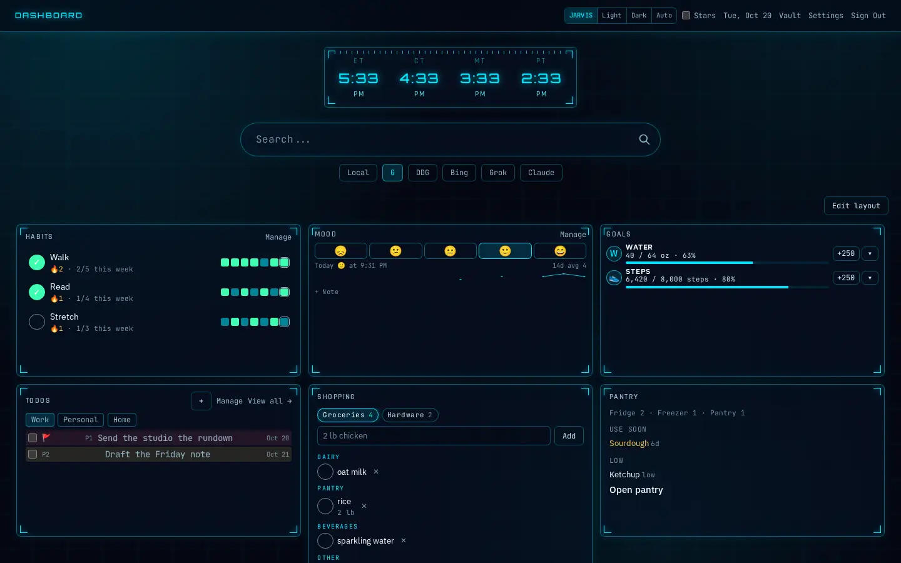

## Screenshots

These frames use a fictional demo account. Nothing in them is from a live server. Regenerate with `php scripts/seed-demo.php` and `node scripts/capture-screenshots.mjs` (Playwright and `cwebp`).

<table>
<tr>
<td width="32%">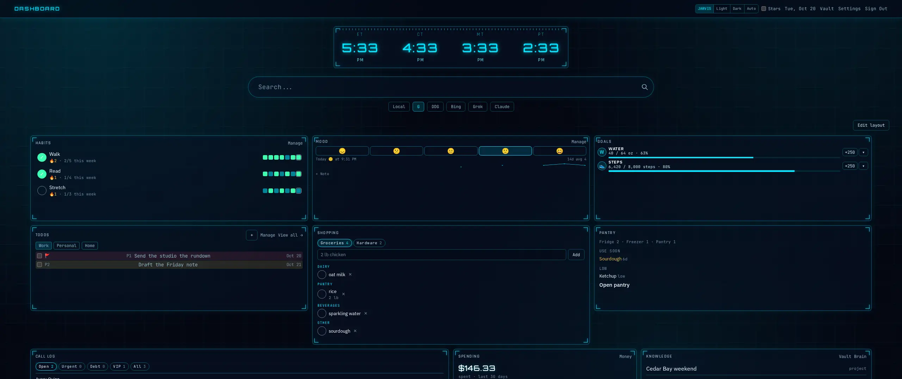<br>Wide desktop, 18 columns</td>
<td width="32%">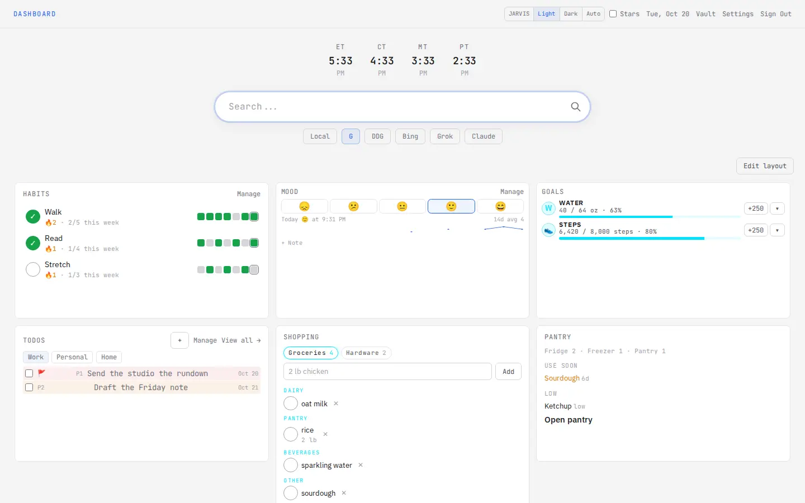<br>Light theme</td>
<td width="32%">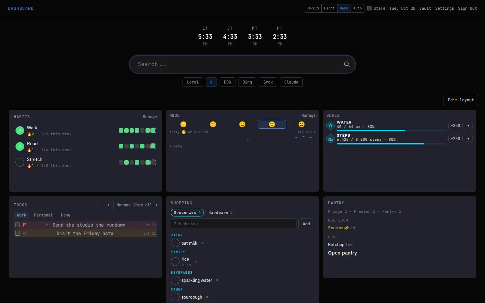<br>Dark theme</td>
</tr>
<tr>
<td>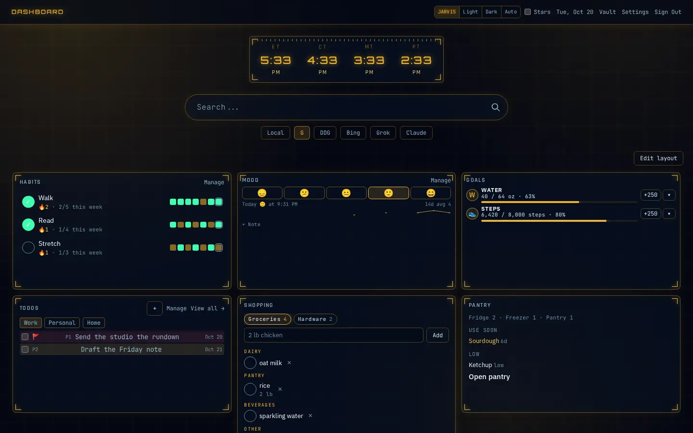<br>JARVIS theme, amber accent</td>
<td>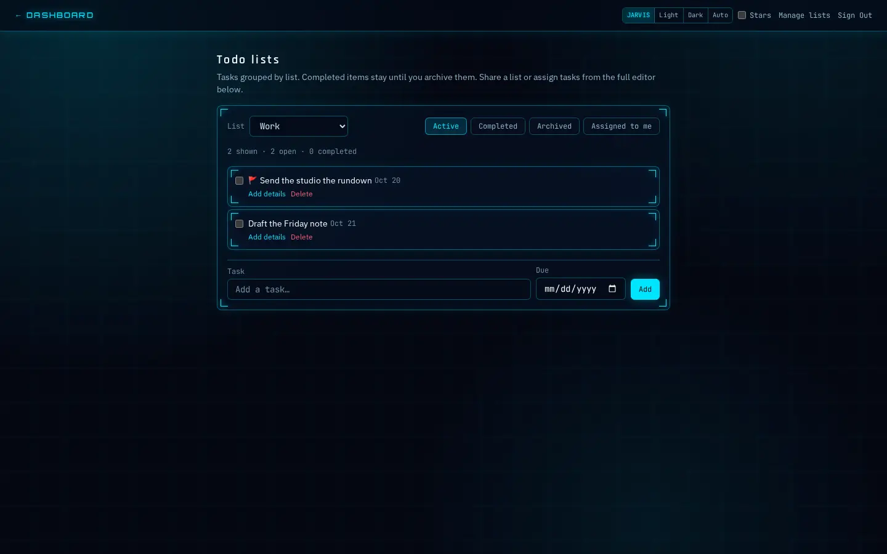<br>Todo lists</td>
<td>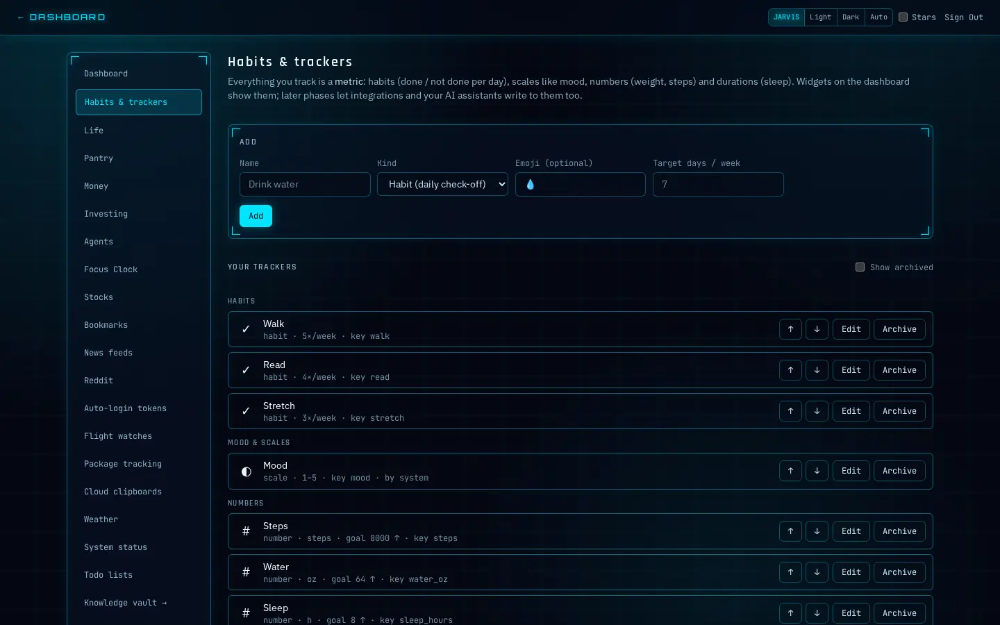<br>Habits and metrics</td>
</tr>
<tr>
<td>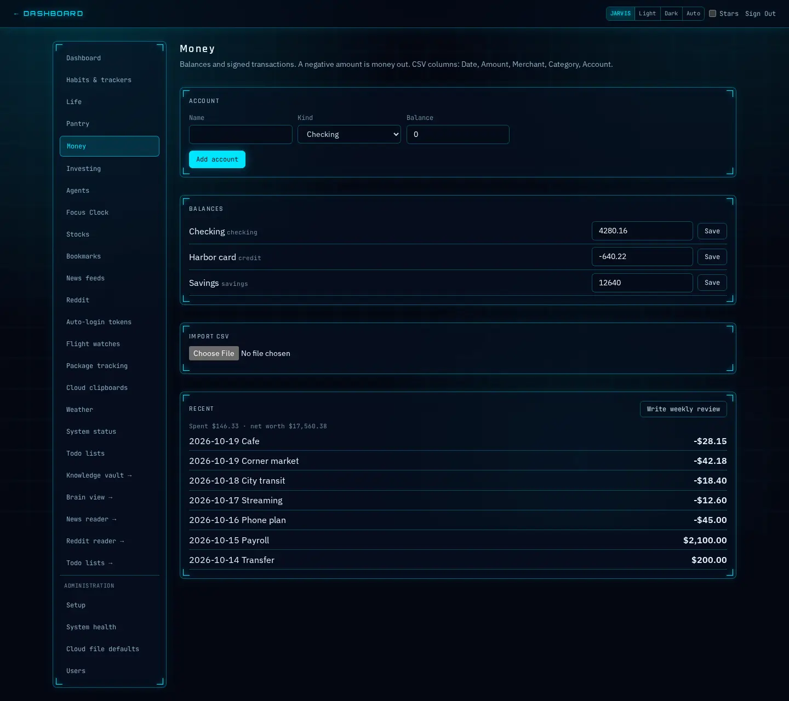<br>Balances and transactions</td>
<td>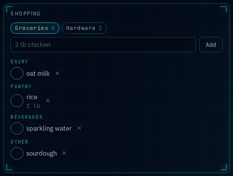<br>Shopping lists</td>
<td>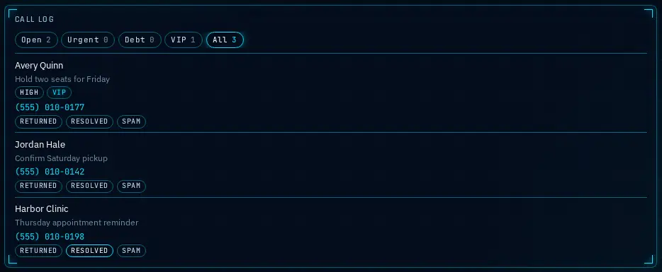<br>Call log</td>
</tr>
<tr>
<td>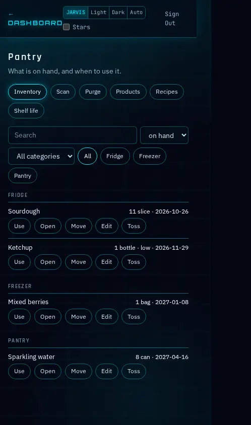<br>Pantry inventory, phone width</td>
<td>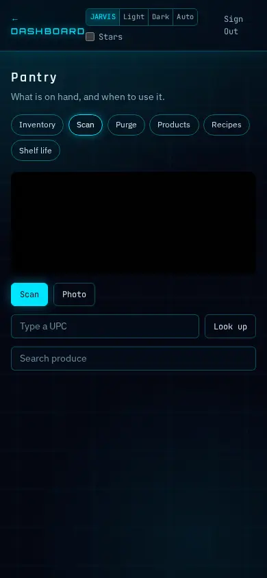<br>Pantry scan, phone width</td>
<td>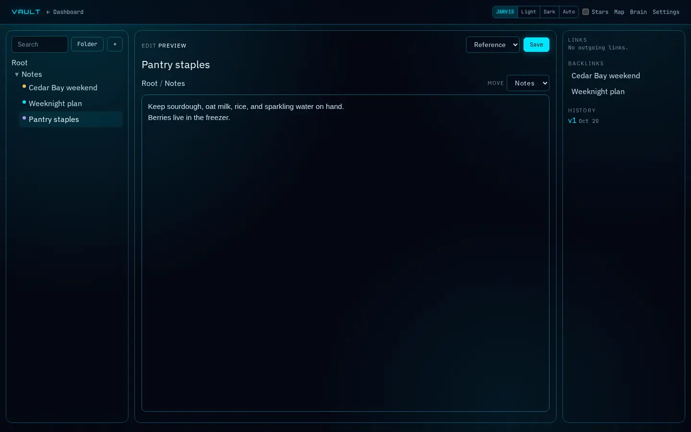<br>Vault page</td>
</tr>
<tr>
<td>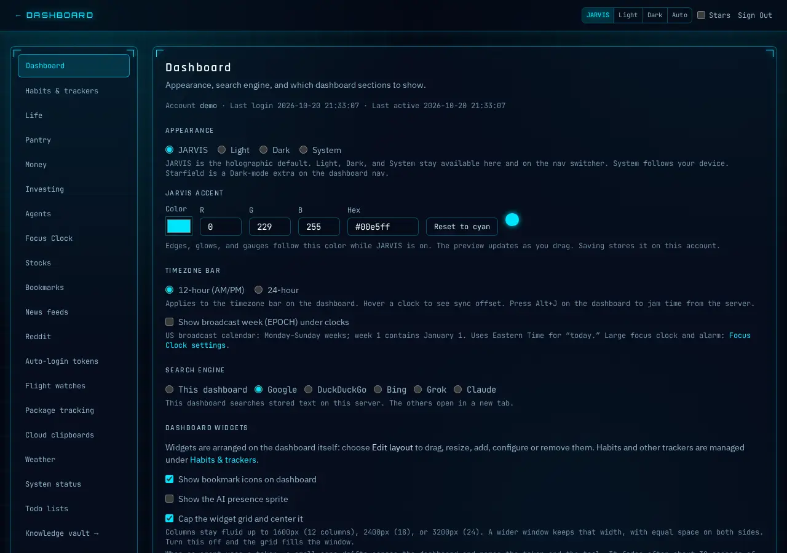<br>Settings, theme and accent</td>
<td>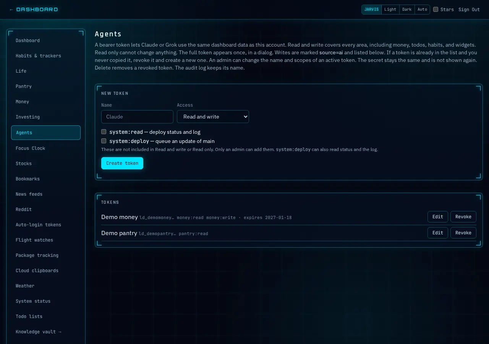<br>Agent tokens, prefixes only</td>
<td></td>
</tr>
</table>

## Features

- **Widget grid** — drag, resize, add, configure and remove widgets (GridStack, 12 columns; single column on phones). Layout and config live in PostgreSQL, every config change is versioned with one-click restore, and widgets update live over WebSocket
- **Habits** — daily check-off, streaks, week target, 7/14-day strip (tap a past day to backfill), quick-add from the widget
- **Mood** — 1–5 faces with an optional note, today's entry, 30-day trend and recent notes
- **Data widgets** — stat, chart (line/bar, up to 4 metrics), gauge, recent entries, streak — on top of generic metrics/datapoints that integrations and AI assistants will write to (L2+)
- **Search** — Google, DuckDuckGo, Bing, Grok, Claude (per-user preference)
- **4 US Timezone Clocks** — ET / CT / MT / PT, live; optional broadcast week (EPOCH)
- **RSS News Feed** — 30+ built-in sources across tech, developer, mobile, hardware, enterprise, Microsoft, broadcast, and news categories; merged timeline; `/news` reader
- **Reddit** — track subreddits on Settings → Reddit (hot/new/top, keyword filters). Posts are saved on the server and shown at `/reddit` and on the Reddit reader widget. An assistant reads them through MCP. A token can be limited to Reddit only. The rotating Reddit card is separate and still uses the list typed into that widget
- **Spotify** — connect a Premium account, sync playlists and play history, stage playlist edits, and play in the browser. See [Spotify](#spotify)
- **Money** — accounts, transactions, budget, debt snowball, sinking funds, Baby Step, food week, bills due, retirement vs 15%, and credit score. A one-time CSV import copies a spreadsheet into Postgres (`docs/money-import.md`). A money-only agent token expires in 90 days
- **Weather Widget** — OpenWeatherMap free tier, browser geolocation
- **Bookmarks** — per-user folders with favicons, bookmarklet capture, collapsible links
- **Flight Watches** — OpenSky ADS-B (optional FlightAware); polls 24h before departure via cron
- **Package Tracking** — direct UPS/FedEx/DHL APIs; USPS/Amazon/OnTrac/LaserShip link-only; cron every 2h
- **System Status** — user-defined ping targets (HTTP/TCP)
- **Stocks** — Alpha Vantage quotes for a user watchlist (cron-cached)
- **Cloud Clipboards** — multi-board plain text sync with Markdown preview; dashboard widget for pinned boards
- **Cloud Files** — local file storage + optional Dropbox / S3 on clipboards **Files** tab
- **CloudPad** — Excalidraw infinite canvas on clipboards **CloudPad** tab + full-screen editor; sharing, PNG export
- **Todo Lists** — dashboard widget, full page at `/todos`, sharing and assignment
- **Focus Clock** — `/clock` full-viewport clock with alarm (`Alt+Shift+C` from dashboard)
- **Auth** — session login + auto-login tokens (`/auto/{64-char token}`) with per-token expiry and revoke/regenerate. The database stores SHA-256 of the token.
- **Multi-user ready** — per-user preferences, feed toggles, bookmarks
- **Appearance** — JARVIS is the default. Light, Dark, and Auto stay available. The accent color is per user under Settings → Dashboard → Appearance (synced across devices)

## Stack

| Layer | Technology |
|---|---|
| OS | Ubuntu Server 26.04 LTS (Minisforum AI X1 Pro 470) |
| Web | Apache 2.4 (event MPM) → PHP-FPM 8.5 over a Unix socket |
| Database | PostgreSQL 18 (Unix-socket peer auth, huge pages), pgvector from Phase L4 |
| App | Server-rendered PHP + vanilla JS, Tailwind CSS (pre-built) |
| Services | Python 3 (`services/` — MCP server, sync workers, realtime push from Phase L1+) |
| Scheduling | systemd timers (`deploy/systemd/`) — replaces the Dreamhost crontab |
| Secrets | `systemd-creds` (TPM2-bound) → decrypted to tmpfs at boot |
| Access | LAN HTTPS (`dash.<domain>`, Let's Encrypt via Cloudflare DNS) + UniFi Teleport remotely · Cloudflare Tunnel (`dash.<domain>` for the app, `mcp.<domain>` for MCP) |
| Backups | `pg_dump` nightly + restic offsite (S3 or Dropbox via rclone) |

## Project Structure

```
/
├── bootstrap.php           # App bootstrap (config, autoload, helpers)
├── composer.json
├── .env.example            # Config template — copy to .env
├── public/                 # Web root — point Apache here
│   ├── index.php           # Front controller
│   ├── .htaccess           # URL rewriting + security
│   └── assets/
│       ├── css/
│       │   ├── tailwind.css   # built — run npm run build:css after template/class changes
│       │   ├── dashboard.css
│       │   └── lifedash.css   # widget grid + native widgets (plain CSS, no build)
│       ├── vendor/gridstack-12.6.0/  # vendored GridStack (MIT)
│       └── js/
│           ├── lifedash-api.js        # /api/v1 client + formatters
│           ├── lifedash-grid.js       # grid, edit mode, add/configure/history
│           ├── lifedash-renderers.js  # native widget renderers (SVG charts)
│           ├── lifedash-realtime.js   # WebSocket + polling fallback
│           ├── lifedash-trackers.js   # /settings/trackers
│           ├── dashboard.js
│           ├── clipboards.js
│           ├── clipboard-widget.js
│           ├── widgets.js
│           ├── flights-manage.js
│           └── packages-manage.js
├── src/
│   ├── Config.php
│   ├── Auth/Auth.php
│   ├── Api/                  # JSON handlers (Api/V1 = /api/v1 platform API)
│   ├── Tracking/             # metrics, datapoints, habits (L1)
│   ├── Widgets/              # widget type registry, grid, widget data (L1)
│   ├── Bookmark/
│   ├── Settings/
│   ├── Clipboard/
│   ├── Flight/               # OpenSky + FlightAware providers
│   ├── Package/              # UPS/FedEx/DHL + link-only carriers
│   ├── Ping/
│   ├── Stock/
│   ├── Support/HttpClient.php
│   ├── DB/
│   └── Router/
├── templates/
│   ├── dashboard.php
│   ├── clipboards.php
│   ├── flights.php
│   ├── packages.php
│   ├── login.php
│   ├── settings.php
│   └── settings/
│       ├── _nav.php
│       └── tokens.php
│   └── errors/500.php
├── cron/
│   ├── fetch_feeds.php
│   ├── fetch_flights.php
│   ├── fetch_packages.php
│   ├── ping_targets.php
│   └── fetch_stocks.php
├── resources/
│   └── css/tailwind.css      # Tailwind source (@tailwind directives)
├── package.json              # npm run build:css (dev only; commit built tailwind.css)
├── tailwind.config.js
├── scripts/
│   └── migrate.php         # DB migration + first-run setup
└── storage/                # NOT in web root
    ├── dashboard.db        # SQLite database
    ├── cache/
    │   ├── rss/
    │   └── weather/
    └── logs/
```

life-dashboard additions:

```
├── database/pgsql/          # Versioned PostgreSQL migrations (NNNN_name.sql)
├── setup.sh                 # One-command install: place app, secrets, provision, DB init, verify
├── deploy/
│   ├── provision.sh         # Server configuration (called by setup.sh; idempotent)
│   ├── apache/ php/ postgresql/ systemd/
│   ├── bin/                 # lifedash-deploy, -env, -backup, -job, -tunnel-setup
│   └── backup.env.example
├── services/                # Python package `lifedash` (config, db, log, healthcheck)
├── scripts/
│   ├── migrate-sqlite-to-pgsql.php   # One-shot import from personal-dashboard
│   └── sql-lint-pgsql.php            # PREPAREs every SQL string against PostgreSQL
└── tests/
    ├── Unit/ Integration/   # PHPUnit
    └── smoke/smoke_http.py  # End-to-end HTTP smoke test (stdlib Python)
```

## Server setup (home server)

Assumes a fresh **Ubuntu Server 26.04 LTS** install, reachable over SSH on your LAN.

### Quick start — `setup.sh`

```bash
git clone https://github.com/davidmcferrin-spec/life-dashboard.git
cd life-dashboard
sudo ./setup.sh
```

`setup.sh` does the whole install in one pass and is safe to re-run:

1. Places the app at `/srv/lifedash/app` (cloned from your checkout, so root needs no GitHub credentials)
2. Asks for the HTTPS details (dashboard hostname, Let's Encrypt email, Cloudflare DNS token) and any extra subnet to allow (your Teleport range)
3. Builds the `.env`: asks for your existing `APP_SECRET` (reuse the Dreamhost one when migrating) and time zone, then encrypts it and deletes the plaintext
4. Runs `deploy/provision.sh`: packages, PostgreSQL, Apache, PHP-FPM, HTTPS certificate, timers, backups, firewall, cloudflared
5. Keeps `APP_URL` / `SESSION_SECURE` in the encrypted `.env` matched to HTTP or HTTPS mode
6. Initialises the database: creates a new admin user, or imports personal-dashboard
7. Verifies `/healthz` and `lifedash-healthcheck`

Re-runs remember the HTTPS and firewall settings (`/etc/lifedash/provision.conf`), so a plain `sudo ./setup.sh` is enough later.

Useful flags:

| Flag | Effect |
|---|---|
| `--env-file FILE` | use an existing `.env` (e.g. Dreamhost's with the DB block edited) |
| `--import-sqlite FILE` `--uploads DIR` | import personal-dashboard data and uploaded files |
| `--skip-orphans` `--truncate-long` | importer tolerances (see migration section) |
| `--fresh` | new admin user, no import |
| `--yes` | non-interactive, accept defaults |
| `--dry-run` | print every action without changing anything |
| `--ui-host` `--acme-email` `--cf-token-file` | HTTPS settings (prompted if omitted) |
| `--allow-cidr CIDR` | extra firewall source range, repeatable (UniFi Teleport subnet) |
| `--skip-tls` | HTTP only for now |
| `--lan-cidr` `--with-tailscale` `--skip-firewall` `--skip-cloudflared` | passed through to `provision.sh` |

Example migration in one command:
```bash
sudo ./setup.sh --env-file ~/dreamhost.env --import-sqlite ~/dashboard.db --uploads ~/uploads
```

The steps below are what `setup.sh` automates, for reference or manual installs.

### 1. Clone to `/srv/lifedash/app`

```bash
sudo install -d /srv/lifedash
sudo git clone https://github.com/davidmcferrin-spec/life-dashboard.git /srv/lifedash/app
```

(Private repo: use a GitHub fine-grained token with read access to this repo, or a deploy key. `lifedash-deploy` pulls as root, so root needs this access for later updates.)

### 2. Prepare the `.env`

Start from `.env.example`. If you are migrating, start from your **Dreamhost `.env`** instead and change only the database block — **keep `APP_SECRET`** (it signs sessions and encrypts stored Dropbox/S3 credentials):

```ini
DB_DRIVER=pgsql
DB_PGSQL_SOCKET_DIR=/var/run/postgresql
DB_NAME=lifedash
DB_USER=lifedash
DB_PASS=
APP_URL=https://dash.<yourdomain>
AUTO_MIGRATE=false
```

### 3. Provision

```bash
sudo /srv/lifedash/app/deploy/provision.sh --env-file /home/you/lifedash.env
shred -u /home/you/lifedash.env        # the encrypted copy is all you need now
```

This installs and configures Apache, PHP-FPM, PostgreSQL (tuned, huge pages), the HTTPS certificate, the Python venv, systemd timers, nightly backups, cloudflared, UFW and fail2ban. It is safe to re-run. See `provision.sh --help` for options.

**Ubuntu 26.04 specifics handled for you**
- **php-fpm, not mod_php:** 26.04's Apache unit sets `MemoryDenyWriteExecute=yes`, which breaks PHP's JIT under mod_php.
- **Huge pages for PostgreSQL:** a Linux 7.0 change causes a large PostgreSQL slowdown unless shared memory uses huge pages. The script sizes `vm.nr_hugepages` from `postgres -C shared_memory_size_in_huge_pages` and checks `huge_pages_status`.

### 4. HTTPS on the LAN (and over Teleport)

You need a domain on **Cloudflare DNS** (a Cloudflare Registrar domain works as-is). The same domain serves the certificate and the public MCP tunnel.

1. **Cloudflare API token:** dash.cloudflare.com → My Profile → API Tokens → Create → *Edit zone DNS* template → Zone Resources: *Include → Specific zone → your domain*. `setup.sh` asks for it (input hidden) and stores it root-only in `/etc/lifedash/cloudflare.ini`.
2. **Certificate:** certbot proves ownership with a DNS TXT record (DNS-01), so the dashboard name never needs a public A record and your LAN IP stays private. Renewal is automatic (`certbot.timer`), and Apache reloads on renewal.
3. **Local DNS on the UDM:** add a record `dash.<yourdomain>` → the server's LAN IP (UniFi Network → Settings → Routing → DNS, or Policy Engine → DNS on newer UniFi OS versions). `setup.sh` prints the exact IP.
4. **Teleport:** connected devices use the UDM for DNS, so `https://dash.<yourdomain>` works on the road too. If Teleport clients get their own subnet, allow it: `sudo ./setup.sh --allow-cidr <teleport-subnet>`.

Port 80 redirects to HTTPS for everything except loopback, which cloudflared and the on-box health checks use. Without a hostname (`--skip-tls`), the UI runs HTTP-only with `SESSION_SECURE=false` until you add one.

Tailscale is optional (`--with-tailscale`) if you ever want it alongside Teleport.

### 5. Database: fresh start or import

Fresh:
```bash
sudo -u lifedash php /srv/lifedash/app/scripts/migrate.php     # prompts for the admin user
```

Or import personal-dashboard — see [Migrating from personal-dashboard](#migrating-from-personal-dashboard).

### 6. Verify

```bash
curl -s http://127.0.0.1/healthz                                  # {"status":"ok"}
sudo -u lifedash /srv/lifedash/venv/bin/lifedash-healthcheck      # JSON; exit 0 ok / 1 warn / 2 fail
systemctl list-timers 'lifedash-*'
python3 /srv/lifedash/app/tests/smoke/smoke_http.py --base https://dash.<yourdomain> --user <you> --password-env PW
```

`/settings/system` (admin) shows job health and PostgreSQL version, size and pending migrations.

### 7. Offsite backups (when you choose S3 or Dropbox)

```bash
sudo cp /etc/lifedash/backup.env.example /etc/lifedash/backup.env && sudo nano /etc/lifedash/backup.env
openssl rand -base64 32 | sudo tee /etc/lifedash/restic.pass >/dev/null && sudo chmod 600 /etc/lifedash/restic.pass
sudo lifedash-backup init
sudo systemctl start lifedash-backup && journalctl -u lifedash-backup -n 30
```

Until then, nightly `pg_dump`s go to `/var/backups/lifedash` only (7 days). **Save the restic password in your password manager** — without it the backups are unrecoverable.

### 8. Cloudflare Tunnel (dashboard and MCP)

The same Cloudflare zone that issues the LAN certificate can front two public hostnames. `dash.<domain>` is the PHP app, including the realtime socket at `/ws`. `mcp.<domain>` is the MCP server. OAuth consent stays on the dashboard hostname so the existing login session is the approval step.

Create a remotely managed tunnel in Cloudflare Zero Trust and copy its token. Then, signed in as an admin:

1. **Settings → Setup → Public URLs.** Dashboard URL `https://dash.<your-domain>`. MCP URL `https://mcp.<your-domain>/mcp`. Leave MCP bind on **All interfaces** until every existing bot uses the tunnel. **Save**, then **Restart MCP service**. The bind applies after that restart.
2. **Settings → Agents.** **Allow plain HTTP MCP access (LAN IP)** stays on so a bot that still uses `http://<lan-ip>:8765/mcp` keeps working. That checkbox is the switch. **Save**. A bearer token cannot change it.
3. **Settings → Tunnel.** Paste the tunnel token. Dashboard hostname `dash.<your-domain>`. MCP hostname `mcp.<your-domain>`. **Save**. Copy the two routes into the tunnel's public hostname routes in Zero Trust:
   - `dash.<your-domain>` → `http://localhost:80`
   - `mcp.<your-domain>` → `http://localhost:8765`

   **Start**. The page shows Connected or Not connected. **Stop** and **Restart** are on the same page.

The dashboard route origin is port 80. cloudflared reaches Apache on loopback. The LAN UI stays on HTTPS. A tunnel that already has `/etc/cloudflared/config.yml` still starts when this page has no token saved.

Turning plain HTTP off does not change the listen address and does not need a restart. The next plain HTTP JSON-RPC call gets HTTP 403 and the message names the MCP URL. A request cloudflared proxies (loopback, `X-Forwarded-Proto: https`) still works. MCP bind stays on all interfaces. Choose **Loopback only** on Settings → Setup and press **Restart MCP service** only when you also want the LAN port closed. After that, a LAN client is refused at connect time and does not see the 403. The tunnel still dials `127.0.0.1:8765`.

In Claude, add a custom connector with this URL:

```text
https://mcp.<your-domain>/mcp
```

Claude opens `https://dash.<your-domain>` for consent. Sign in if that browser is not already signed in, then allow the scopes. Static bearer tokens on Settings → Agents are unchanged.

LAN access by IP is unchanged. A forwarded `https` scheme is trusted only when the connection comes from cloudflared on localhost. Details: [docs/deploy/cloudflare-access.md](docs/deploy/cloudflare-access.md).

## Day-to-day operations

| Task | Command |
|---|---|
| Re-run full setup | `sudo ./setup.sh` (from a checkout; idempotent) |
| Deploy latest `main` | `sudo lifedash-deploy` (pull → deps → pre-migration dump → migrate → reload → verify). Agents can queue the same update: [docs/deploy/self-update.md](docs/deploy/self-update.md) |
| Integration settings | Settings → Setup (Spotify, weather, public URLs, MCP bind). Secrets show the last 4 characters, with Replace and Clear |
| Restart MCP | Settings → Setup → Restart MCP service |
| Tunnel | Settings → Tunnel (token, hostnames, Start / Stop / Restart) |
| Boot secrets | `APP_SECRET` and the database password stay in the environment `setup.sh` installs (`sudo lifedash-env edit` is only for those) |
| Run a job now | `sudo systemctl start lifedash-job@feeds` (feeds, flights, packages, pings, stocks, shares, prune) |
| Job logs | `storage/logs/<job>.log` · `journalctl -u 'lifedash-job@*'` |
| Backup now / list | `sudo systemctl start lifedash-backup` · `sudo lifedash-backup snapshots` |
| PHP errors | `storage/logs/php-error.log` · `/var/log/apache2/lifedash_error.log` |
| CheckMK | local check `lifedash` is installed automatically if the agent is present |
| Realtime push | `systemctl status lifedash-push` · `journalctl -u lifedash-push -o cat \| jq` (UI falls back to 60 s polling while it is down) |

## Migrating from personal-dashboard

1. **Copy data off Dreamhost** (the SQLite file and uploaded files):
   ```bash
   scp dh_w9tij7@<dreamhost-host>:personal-dashboard/storage/dashboard.db /tmp/dashboard.db
   rsync -a dh_w9tij7@<dreamhost-host>:personal-dashboard/storage/uploads/ /tmp/uploads/
   ```
2. **Dry run** (read-only; checks every row for type, length and foreign-key problems):
   ```bash
   sudo -u lifedash php /srv/lifedash/app/scripts/migrate-sqlite-to-pgsql.php --sqlite=/tmp/dashboard.db --dry-run
   ```
   If it reports orphaned rows (children whose parent was deleted), add `--skip-orphans`. For over-length text, add `--truncate-long`.
3. **Import** (single transaction; ids preserved; sequences reset; row counts verified):
   ```bash
   sudo -u lifedash php /srv/lifedash/app/scripts/migrate-sqlite-to-pgsql.php --sqlite=/tmp/dashboard.db
   sudo -u lifedash php /srv/lifedash/app/scripts/migrate.php     # re-apply feed seeds/repairs
   sudo rsync -a /tmp/uploads/ /srv/lifedash/app/storage/uploads/ && sudo chown -R lifedash:lifedash /srv/lifedash/app/storage/uploads
   ```
4. Log in with your existing account. Auto-login links still work: import stores only a SHA-256 of each existing token, and the same link you already have matches that hash. Shared boards and files still need the same `APP_SECRET`.
5. Update any Dropbox app redirect URI to `{APP_URL}/api/storage/oauth/callback/dropbox`.

## Local development

```bash
cp .env.example .env            # DB_DRIVER=pgsql with DB_HOST=127.0.0.1, or DB_DRIVER=sqlite offline
php scripts/migrate.php
php -S 127.0.0.1:8080 -t public public/index.php
```

Tests:
```bash
composer install
vendor/bin/phpunit --testsuite unit
# PostgreSQL integration tests wipe the target DB — its name must end in _test:
LIFEDASH_TEST_PG_DB=lifedash_test LIFEDASH_TEST_PG_PASS=... vendor/bin/phpunit
php scripts/sql-lint-pgsql.php                        # every SQL string PREPAREd against PostgreSQL
cd services && pip install -e ".[dev]" && pytest -q
```

Tailwind and the CloudPad bundle are still built on the dev machine and committed (`npm run build:css`, `npm run build:cloudpad`); the server never runs npm.

## Package Tracking

Manage watches at `/packages`; active in-transit packages appear on the dashboard widget (add or remove it via **Edit layout** on the dashboard).

| Carrier | Live status on dashboard | Setup |
|---|---|---|
| UPS | Yes | `UPS_CLIENT_ID` / `UPS_CLIENT_SECRET` in `.env` — [UPS Developer Portal](https://developer.ups.com) |
| FedEx | Yes | `FEDEX_CLIENT_ID` / `FEDEX_CLIENT_SECRET` — [FedEx Developer Portal](https://developer.fedex.com) |
| DHL | Yes | `DHL_API_KEY` — [DHL Developer](https://developer.dhl.com) (unified tracking API) |
| USPS | Link only | No API key; deep link to USPS tracking (recipient API requires shipper MID) |
| Amazon | Link only | No API key; optional custom order URL per watch |
| OnTrac | Link only | No API key |
| LaserShip | Link only | No API key |

Cron: `cron/fetch_packages.php` every 2 hours (`lifedash-job-packages.timer`). Config: `PACKAGE_POLL_MINUTES` (default 120), `PACKAGE_MAX_PER_USER` (default 10), `PACKAGE_PURGE_DAYS` (default 7). Set `PACKAGES_SANDBOX=true` for UPS CIE / FedEx sandbox during development.

### Package API

All routes require an authenticated session. POST bodies are JSON with `X-CSRF-Token` header.

| Method | Path | Description |
|--------|------|-------------|
| GET | `/api/packages` | List active watches (dashboard widget) |
| GET | `/api/packages?all=1` | List all incomplete watches (manager page) |
| POST | `/api/packages/create` | Add watch `{ "tracking_number", "carrier"?, "label"?, "external_url"? }` |
| POST | `/api/packages/{id}/update` | Update fields |
| POST | `/api/packages/{id}/delete` | Delete watch |

Carrier values: `auto`, `ups`, `fedex`, `dhl`, `usps`, `amazon`, `ontrac`, `lasership`.

## Cloud Clipboards API

All routes require an authenticated session. POST bodies are JSON with `X-CSRF-Token` header (or `_csrf` in form data).

| Method | Path | Description |
|--------|------|-------------|
| GET | `/api/clipboards` | List boards (`?pinned=1` for dashboard widget) |
| GET | `/api/clipboards/{id}` | Get content (`?since_version=N` for polling) |
| POST | `/api/clipboards/create` | Create board `{ "name", "pin_to_dashboard"? }` |
| POST | `/api/clipboards/{id}/save` | Save `{ "content", "version" }` — 409 on conflict |
| POST | `/api/clipboards/{id}/settings` | Update `{ "name"?, "pin_to_dashboard"?, "auto_save"? }` |
| POST | `/api/clipboards/{id}/delete` | Delete board |

Default boards on first use: **Main** (pinned), **Scratch**. Edit | Preview toggles client-side Markdown rendering (storage stays plain text).

Sharing: public links (`/share/clipboard/{token}`) and in-app user shares on each board.

### Files (Cloud clipboards → Files tab)

| Method | Path | Description |
|--------|------|-------------|
| GET | `/api/files` | List owner files + quota |
| GET | `/api/files/shared-with-me` | Files shared with this user |
| POST | `/api/files/upload` | Multipart upload (`file` field) |
| GET | `/api/files/{id}/download` | Download (owner or in-app share) |
| POST | `/api/files/{id}/delete` | Delete (owner only) |
| GET | `/api/files/{id}/shares` | List share links + users |
| POST | `/api/files/{id}/shares/link` | Create public link `{ "label"?, "expires_in"? }` |
| POST | `/api/files/{id}/shares/user` | Share with user `{ "identifier" }` |

Public download: `/share/file/{token}` · `GET /api/share/file/{token}/download`

Allowed types: JPEG, PNG, GIF, WebP, ZIP, EXE, MSI — max 50 MB (`FILES_MAX_BYTES`).

Expired public share links (clipboard, local file, cloud file) are purged daily by `cron/prune_share_links.php` after `SHARE_LINK_PURGE_HOURS` (default 24) beyond `expires_at`. Links with no expiry are kept until manually revoked.

## Spotify

Create an app at https://developer.spotify.com/dashboard and add the redirect URI exactly.

The dashboard is often opened by IP address. Spotify only accepts an HTTPS redirect, or `http://127.0.0.1` / `http://localhost`. Two ways to connect:

1. Set `SPOTIFY_REDIRECT_URI` to an HTTPS hostname that reaches this server, for example `https://dash.example.com/settings/spotify/callback`.
2. For a one-time connect, forward a local port over SSH and use `http://127.0.0.1:PORT/settings/spotify/callback`.

The in-browser player also needs the page itself on HTTPS or `http://127.0.0.1`. A plain `http://` IP address can sync playlists, but the Web Playback SDK will not start there.

**Settings → Setup → Spotify.** Client id, client secret (Replace), redirect URI, and sync interval in minutes. The redirect field suggests `https://<dashboard host>/settings/spotify/callback` from the Dashboard URL and has a copy button. Save. The playback key is generated on first use and stored outside the web root. Then **Settings → Spotify → Connect**.

The **Player** button in the dashboard header shows or hides the floating player on this browser immediately. Drag the grip in the player header. **Reset** returns it to the corner. It stays on other pages until you turn it off. The same button on Settings → Spotify follows that choice.

## API Keys

| Service | URL | Free Tier |
|---|---|---|
| OpenWeatherMap | https://openweathermap.org/api | 1,000 calls/day |
| Alpha Vantage | https://alphavantage.co | 25 requests/day |
| OpenSky OAuth2 | https://opensky-network.org/my-opensky/account | Free (rate limits) |
| FlightAware AeroAPI (optional) | https://flightaware.com/commercial/aeroapi | ~$5/mo personal credit |
| UPS Developer | https://developer.ups.com | Free (tracking API) |
| FedEx Developer | https://developer.fedex.com | Free (tracking API; link FedEx account for production) |
| DHL Developer | https://developer.dhl.com | Free tier varies (unified tracking API key) |

Link-only carriers (USPS, Amazon, OnTrac, LaserShip) require no API keys.

## News Sources

Built-in feeds (`feed_sources.category`):

| Category | Sources |
|---|---|
| Tech | How-To Geek, Slashdot, Lifehacker, Ars Technica, The Verge, Engadget |
| Developer | XDA Developers, DevNet Academy |
| Mobile | SamMobile, MacRumors |
| Hardware | Tom's Hardware, AnandTech (archive — site stopped publishing 2024) |
| Enterprise | IT Pro, TechRadar Pro, TechRepublic |
| Microsoft | Windows Central, Petri, Thurrott.com, Neowin, Ask Woody, Scott Hanselman |
| Broadcast | TV Technology, NAB News |
| News | NewsNation, CBS, ABC, NBC, Fox, CNN, Newsweek, Washington Examiner, WSJ, BBC World |
| Tesla/EVs | Not a Tesla App, Teslarati, Electrek, InsideEVs |
| AI/Development | Anthropic News, Pragmatic Engineer, GitHub Blog, Cursor Changelog, GetStream AI News, xAI News |

Default dashboard pins (new users): tech + developer + mobile + hardware + enterprise (IT Pro, TechRadar Pro) + broadcast + NewsNation. Mainstream news, Microsoft, Tesla/EVs, and AI/Development feeds are opt-in on `/settings/feeds`. Run `php scripts/migrate.php` after deploy to seed new sources and repair categories.

## Todo lists

Grid dashboard widget + full page at `/todos`. Default lists: Work, Personal, Home.

| Feature | Location |
|---|---|
| Quick check-off + add | Dashboard widget |
| Notes, links, archive, assign | `/todos` |
| List tabs, share, dashboard pin | `/settings/todos` |

## Roadmap

life-dashboard phases use an **L** prefix to avoid confusion with personal-dashboard's Phases 1–8 (all complete: foundation, widgets, RSS, clipboards/flights/pings/stocks, settings, packages/focus clock/files, todos, CloudPad).

- [x] **L0 — Foundation:** PostgreSQL driver + baseline schema, SQLite importer, SQL lint, Ubuntu 26.04 deploy kit (Apache/PHP-FPM/PostgreSQL/systemd timers), encrypted secrets, backups, LAN HTTPS + Cloudflare Tunnel, Python services foundation, CI
- [x] **L1 — Core platform:** metrics/datapoints, versioned widget grid (drag/resize/add/configure/rollback), native renderers, habits + mood, `/api/v1`, realtime push (LISTEN/NOTIFY → WebSocket), existing widgets ported onto the grid
- [x] **L2 — MCP v1:** scoped bearer tokens, audit log, `/api/v1` for session or token, Python MCP server on `0.0.0.0:8765` (`/mcp`), generated agent prompt
- [x] **L3 — Life tracking:** sleep, steps, exercise, weight, travel day; Health Connect ingest; Home Assistant webhook
- [x] **L4 — Second brain:** Markdown vault (`/brain`), tree, revisions, backlinks, full-text and optional Ollama semantic search, 3D brain (`/brain/graph`) driven by the audit log
- [x] **L5 — Money visibility:** accounts, CSV import (Monarch-style), spending and net-worth widgets, weekly review page in the vault
- [x] **L6 — Investing observer:** read-only positions and activity (Robinhood CSV), public Polymarket wallet refresh, scorecard widget. No order placement
- [x] **L7 — Custom widgets:** sandboxed iframe (`sandbox="allow-scripts"`, no parent access), `window.__DATA__` for attached metrics

## Platform API (`/api/v1`)

Session-authenticated JSON (every POST needs the `X-CSRF-Token` header). Errors: `{"error", "fields"}` with 422 / 404 / 400. L2 adds scoped bearer tokens for MCP on the same handlers.

| Method | Path | Purpose |
|---|---|---|
| GET/POST | `/api/v1/metrics` | List (`?kind=`, `?archived=1`) / create `{name, kind, unit?, key?, config?}` |
| GET · POST | `/api/v1/metrics/{id}` · `/update` · `/archive` | Read · rename/config · archive/restore (kind and key are immutable) |
| POST | `/api/v1/metrics/reorder` | `{ids:[…]}` |
| GET/POST | `/api/v1/metrics/{id}/datapoints` | List (`from`, `to`, `limit`) / record `{value, ts?, date?, note?, dedupe_key?}` |
| GET | `/api/v1/metrics/{id}/series` | `bucket=day\|week\|month`, `agg=avg\|sum\|min\|max\|count\|last`, `from`, `to` |
| POST | `/api/v1/datapoints/{id}/delete` | Delete one entry |
| GET · POST | `/api/v1/habits` · `/api/v1/habits/{id}/toggle` | Summary (streaks, week counts, history) · toggle `{date?}` (last 30 days) |
| GET | `/api/v1/widget-types` | Type catalogue with config schemas |
| GET/POST | `/api/v1/widgets` | List / create `{type, title?, config, x?, y?, w?, h?}` |
| GET | `/api/v1/widgets/{id}` · `/data` · `/revisions` | Definition · rendered data · version history |
| POST | `/api/v1/widgets/{id}/update` · `/rollback` · `/delete` | `{title?, config?}` · `{version}` · — |
| POST | `/api/v1/layout` | `{items:[{id,x,y,w,h}]}` (12-column grid) |
| GET | `/api/v1/realtime/token` | 120 s WebSocket ticket |

Metric kinds: `habit` (0/1, one per local day), `scale` (integers min–max, default mood 1–5), `number`, `duration` (seconds). Dates are local to `APP_TIMEZONE`; timestamps are stored UTC.

## Security Notes

- Auto-login tokens are 64-character random hex strings. The database stores only their SHA-256, the same way API tokens are stored. A link you already have keeps working.
- All sessions are HMAC-validated against `APP_SECRET`
- CSRF tokens on all state-mutating forms
- Secrets are encrypted at rest with `systemd-creds` (TPM2 when available); plaintext exists only in `/run` (tmpfs)
- No database password: PHP and Python connect over the Unix socket with peer auth as the `lifedash` OS user
- PostgreSQL listens on localhost only; UFW admits 22/80/443 from the LAN and explicitly allowed subnets (Teleport) only
- Port 80 redirects everything except loopback (cloudflared, on-box checks) to HTTPS; HSTS on :443
- The public tunnel serves the dashboard on `dash.<domain>` and MCP on `mcp.<domain>`. Forwarded HTTPS is trusted only from localhost. Plain HTTP MCP stays on until Settings → Agents turns it off. `MCP_BIND=loopback` is a separate restart and does not happen by itself
- Code is `root:lifedash` read-only to the app; only `storage/` is writable; Apache (www-data) can read `public/` only
- Offsite backups are restic-encrypted client-side and include the decrypted secrets (needed for restore)
- `.env`, `storage/` and code outside `public/` are blocked by Apache even if a rewrite misfires
- Realtime: the WebSocket only accepts an HMAC ticket (120 s, derived key from `APP_SECRET`) sent as the first frame — never in the URL; each socket receives only its own user's events; the push service binds 127.0.0.1
